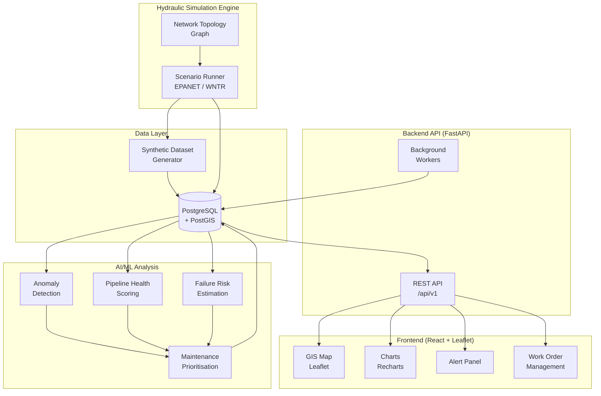

# Architecture — Pune Water Network AI

> **Status:** Draft. This document describes the **planned** high-level architecture. No component beyond the API health endpoint and frontend scaffold has been implemented.

---

## System Overview

The platform is composed of five loosely coupled subsystems that process data from simulation through to dashboard visualisation.



---

## Subsystem Descriptions

### 1. Hydraulic Simulation Engine

- **Responsibility:** Produce synthetic pressure and flow readings for every node and pipe segment in the network topology.
- **Planned tool:** WNTR (Water Network Tool for Resilience) or EPANET via `epynet` bindings.
- **Lead:** Sanskar
- **Key decisions pending:**
  - Selection of WNTR vs direct EPANET CLI
  - Network topology source (synthetic Pune-inspired graph vs open dataset)
  - Simulation time-step granularity (e.g., 15-minute intervals)
  - Leak scenario injection strategy

### 2. Data Layer

- **Database:** PostgreSQL 16 with the PostGIS 3 extension.
- **ORM:** SQLAlchemy (async) with Alembic migrations.
- **Responsibility:** Persistent storage for network topology, pipe attributes, sensor observations, anomaly records, health scores, risk assessments, and maintenance work orders.
- **Lead:** Ruturaj
- **Key decisions pending:**
  - Full entity-relationship schema (see `docs/database-design.md`)
  - Time-series storage strategy (native PostgreSQL TimescaleDB extension vs plain partitioned tables)
  - PostGIS geometry types for pipe segments and network nodes

### 3. AI/ML Analysis

Four models are planned, running as batch jobs triggered after each simulation cycle:

| Model | Purpose | Lead |
|-------|---------|------|
| Anomaly Detector | Classify pressure/flow deviations as leak signatures or normal variation | Shardul |
| Health Scorer | Produce a 0–100 composite score per pipe segment | Shardul |
| Failure Risk Estimator | Estimate probability of failure within a planning horizon | Shardul |
| Maintenance Prioritiser | Rank pipe segments by urgency, cost, and impact | Shardul |

**Key decisions pending:**
- Algorithm selection for each model
- Feature engineering from simulation outputs
- Model evaluation strategy and acceptance thresholds
- Training dataset composition (synthetic vs augmented with real data)

### 4. Backend API (FastAPI)

- **Responsibility:** Expose all data to the frontend over a versioned REST API.
- **Contract:** `shared/api-contract/openapi.yaml`
- **Leads:** Sanskar (infrastructure), Shardul (ML endpoints), Ruturaj (integration)
- **Key decisions pending:**
  - Authentication strategy (JWT, API key, or none for internal MVP)
  - Pagination and filtering conventions
  - Background task runner (FastAPI `BackgroundTasks`, Celery, or APScheduler)
  - WebSocket support for live anomaly streaming (future)

### 5. Frontend (React + Leaflet)

- **Responsibility:** Interactive operations dashboard.
- **Lead:** Bhargavi
- **Planned views:**
  - Network GIS map with pipe health heat map overlay
  - Real-time anomaly alerts panel
  - Pressure/flow trend charts
  - Pipeline health detail panel
  - Maintenance work-order list and prioritisation view
- **Key decisions pending:**
  - GeoJSON tile source for Pune street/pipe network
  - Leaflet tile provider (OpenStreetMap, Mapbox, ESRI)
  - State management library (Zustand, Redux Toolkit, or React Context)
  - Real-time update strategy (polling vs WebSocket)

---

## Cross-Cutting Concerns

| Concern | Approach (Planned) |
|---------|-------------------|
| Error handling | Structured FastAPI exception handlers; typed frontend error boundaries |
| Logging | Structured JSON logs via `structlog` (backend); console + Sentry (frontend) |
| Configuration | Pydantic Settings (backend); Vite env vars (frontend) |
| Testing | pytest + pytest-asyncio (backend); Vitest + RTL (frontend) |
| CI | GitHub Actions (planned — see `.github/workflows/`) |
| Secrets | `.env` files (never committed); future: vault or GitHub Secrets |

---

## Data Flow (Detailed)

```
1. Simulation Engine runs a scenario for the synthetic Pune network
2. Pressure/Flow time-series written to `observations` table in PostgreSQL
3. ML batch job reads new observations
4. Anomaly Detector classifies each reading → writes to `anomalies` table
5. Health Scorer aggregates anomalies + pipe age/material → writes `health_assessments`
6. Failure Risk Estimator reads health assessments → writes `risk_predictions`
7. Maintenance Prioritiser ranks predictions → writes `maintenance_recommendations`
8. Frontend polls REST API for latest network state, anomalies, and work orders
9. Map layer renders pipe segment colours by health score
10. Alert panel surfaces high-severity anomalies in real-time
```

---

## Open Questions

- [ ] Will the network topology be a hand-crafted synthetic graph or derived from an open GIS dataset?
- [ ] Are any official Pune water utility datasets available under a suitable licence?
- [ ] What is the target simulation throughput (segments × time-steps per run)?
- [ ] Should ML models be retrained automatically after each simulation batch?
- [ ] Is TimescaleDB required or are partitioned PostgreSQL tables sufficient?
